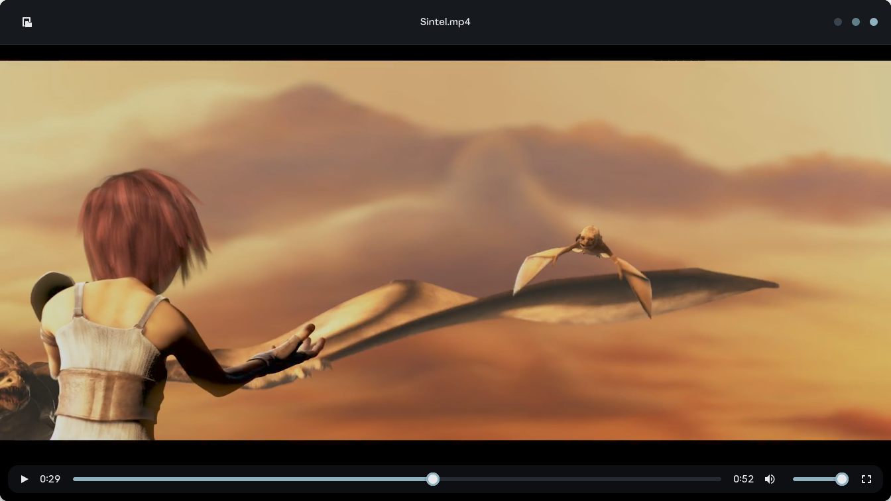

<p align="center">
  
</p>

<h1 align="center">Monet</h1>

<p align="center">A small, fast video player for GNOME.</p>

Monet does one thing: plays your videos and gets out of the way. Built with Rust, GTK4, libadwaita and GStreamer.


<sub>Video: [Sintel](https://durian.blender.org) © Blender Foundation, CC BY 3.0</sub>

## What it does

- Controls fade away while you watch
- Remembers where you stopped
- Window takes the shape of the video (shorts stay tall)
- Uses your GPU to decode when it can, falls back to CPU when it can't
- Drag a video in, or press `Ctrl+O`

## Keys

| Key | Does |
|---|---|
| `Space` | Play / pause |
| `←` `→` | Back / forward 10 seconds |
| `↑` `↓` | Volume |
| `M` | Mute |
| `F` or double-click | Fullscreen |
| `Esc` | Leave fullscreen |

## Build it

You need [Rust](https://rustup.rs) and a few libraries.

**Fedora**

```sh
sudo dnf install gtk4-devel libadwaita-devel gstreamer1-devel \
  gstreamer1-plugin-gtk4 gstreamer1-plugins-good gstreamer1-plugins-bad-free \
  gstreamer1-plugin-libav gstreamer1-plugin-dav1d
```

**Ubuntu / Debian**

```sh
sudo apt install libgtk-4-dev libadwaita-1-dev libgstreamer1.0-dev \
  gstreamer1.0-gtk4 gstreamer1.0-plugins-good gstreamer1.0-plugins-bad \
  gstreamer1.0-plugins-ugly gstreamer1.0-libav
```

Then:

```sh
git clone https://github.com/dashaneka/Monet.git
cd Monet
./install.sh            # installs to ~/.local, no sudo
./install.sh --default  # same, and makes Monet your default video player
```

Monet shows up in your app grid. To just try it without installing: `cargo run --release -- video.mp4`

Needs GTK 4.14+ and libadwaita 1.6+ (Fedora 41+, Ubuntu 25.04+).

## Faster with your GPU

Monet uses hardware decoding on its own if your system has the driver. On Fedora with Intel graphics, the default driver can't decode H.264, HEVC or AV1. Get the full one from [RPM Fusion](https://rpmfusion.org):

```sh
sudo dnf swap libva-intel-media-driver intel-media-driver --allowerasing
```

## Uninstall

```sh
rm ~/.local/bin/monet ~/.local/share/applications/io.github.rajnish.Monet.desktop \
   ~/.local/share/icons/hicolor/scalable/apps/io.github.rajnish.Monet.svg
```

## License

[GPL-3.0-or-later](LICENSE). Use it, change it, share it.
